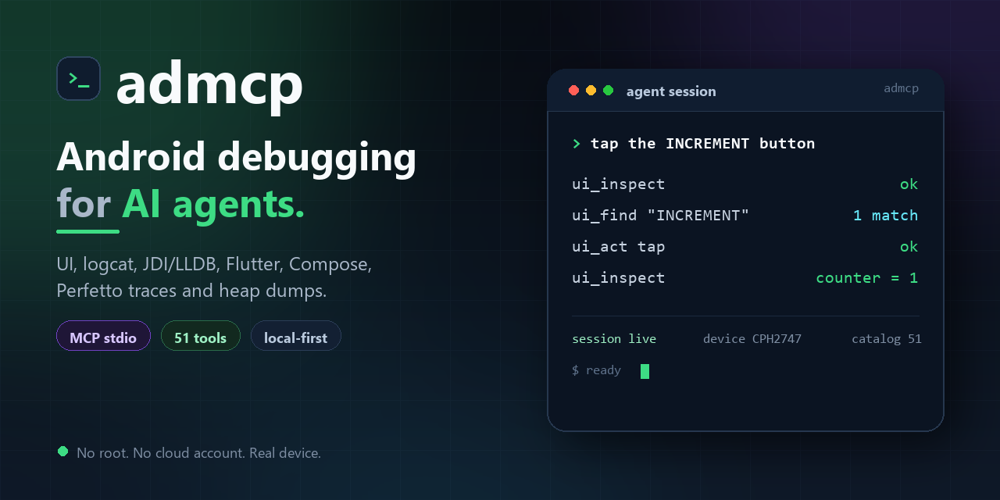
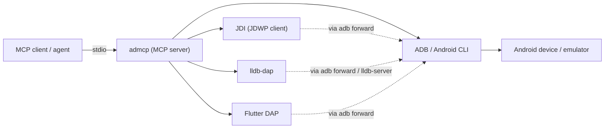

# admcp

<p align="center">
  
</p>

admcp is a local-first Model Context Protocol (MCP) server for Android
development. It connects any MCP stdio client to a real device or emulator and
exposes 51 typed tools for UI inspection, screenshots, logcat, Java/Kotlin JDI
debugging, native LLDB, Flutter/Dart DAP, Compose inspection, Perfetto traces,
heap dumps, artifacts and evidence-based diagnostics.

No root. No cloud account required.

[](https://modelcontextprotocol.io)
[](https://developer.android.com)
[](https://adoptium.net)
[](docs/architecture/mcp-tool-catalog-v1.md)
[](LICENSE)

[Quick start](#quick-start) | [What it can do](#what-it-can-do) |
[Example prompts](#example-prompts) | [Why admcp](#why-admcp) |
[Documentation](#documentation)

> Status: v1, 51 tools, live-tested on a OnePlus CPH2747 (API 36, arm64-v8a).
> Full evidence and remaining limits:
> [implementation status](docs/architecture/implementation-status.md).

## Quick start

1. Install JDK 21 and Android SDK platform-tools (`adb`).
2. Download `admcp-<version>.zip` from [GitHub Releases](../../releases) and
   unzip it. MCPB-compatible clients can install
   `admcp-<version>.mcpb` from the same release instead.
3. Point your MCP client at `bin/admcp.bat` on Windows or `bin/admcp` on
   Linux and macOS.

Any MCP stdio client can use it. The JSON below uses the common `mcpServers`
shape; adapt the command and arguments to your client (Claude Code, Cursor,
VS Code, Codex, Gemini CLI, and similar).

```json
{
  "mcpServers": {
    "admcp": {
      "command": "C:\\Tools\\admcp\\admcp-<version>\\bin\\admcp.bat",
      "args": [
        "--platform-tools", "C:\\Android\\Sdk\\platform-tools",
        "--artifacts", "C:\\temp\\admcp-artifacts"
      ]
    }
  }
}
```

On Linux and macOS, use `/opt/admcp/admcp-<version>/bin/admcp` as `command`.

Verify the install:

```bat
C:\Tools\admcp\admcp-<version>\bin\admcp.bat --selftest
```

On Linux and macOS:

```sh
/opt/admcp/admcp-<version>/bin/admcp --selftest
```

You should see `catalog=51 registered=51 version=<version>` on stderr. The
server then speaks MCP over stdio; stdout is reserved for protocol traffic.

## What it can do

| Area | Tools |
|---|---|
| Device and workspace | `device_list`, `device_inspect`, `toolchain_probe`, `workspace_open`, `workspace_describe` |
| App lifecycle | `app_build`, `app_install`, `app_launch` |
| Sessions | `session_start`, `session_status`, `session_stop` |
| UI and screenshots | `ui_inspect`, `ui_find`, `ui_act`, `ui_screenshot`, `compose_inspect` |
| Logs | `logcat_start`, `logcat_query`, `logcat_stop`, `logcat_statistics`, `logcat_health` |
| Java/Kotlin debug | `debug_attach`, breakpoints, `debug_step`, `debug_stack`, `debug_variables`, `debug_evaluate` |
| Native debug | LLDB attach, breakpoints, stack, registers, memory reads and modules |
| Flutter debug | `DART_DAP` attach, breakpoints, stack, variables, step, pause and detach |
| Performance | Perfetto system traces, heap dumps and `performance_trace_analyze` |
| Artifacts and evidence | `artifact_get`, `analyze_artifact`, previews, `diagnostics_*` and `signals_crashes` |

The full 51-tool contract is in
[docs/architecture/mcp-tool-catalog-v1.md](docs/architecture/mcp-tool-catalog-v1.md).
The catalog is validated by contract tests.

## Example prompts

Once admcp is connected, ask your agent things like:

```text
Inspect the current screen, find the INCREMENT button, tap it, and verify the counter changed.
Start logcat, reproduce the crash, then summarize the stack trace and the last 50 lines before it.
Launch the app, attach JDI, set a breakpoint in MainActivity, and show locals when it hits.
Inspect this Compose screen and tell me which accessibility node is the DELETE COUNTER button.
Record a 5-second Perfetto trace and summarize what happened.
Attach LLDB to the native library, break in fixture_increment, and show the registers.
```

## Why admcp

Many Android MCP tools are thin command wrappers. admcp keeps device, workspace,
process and session state together, then exposes debugging primitives with typed
schemas, artifacts and safety gates.

It is for:

- Android developers who want Claude Code, Cursor or another agent to inspect
  and debug a real device.
- Agent builders who need stable, typed Android actions instead of parsing adb
  strings.
- QA and automation workflows that need reproducible evidence from a device.

| | adb and shell scripts | Android Studio | admcp |
|---|---|---|---|
| Built for AI agents | No | No | Yes |
| Typed MCP tool schemas | No | No | 51 tools |
| Session, process and backend state | No | Partial | Yes |
| JDI, LLDB and Flutter over MCP | No | Human UI | Yes |
| Evidence, artifacts and diagnostics | No | Partial | Yes |
| Local-first, no cloud account | Yes | Yes | Yes |

Android Studio is the better tool for a human sitting at the IDE. admcp is for
the agent that needs to inspect, act and debug without a human driving every
click.

## How it works



The server runs on your machine next to the Android toolchain. It does not
upload your project or device data anywhere.

## Verified

- `186` tests with `0` failures on the verified host.
- The catalog registers all `51` tools over MCP stdio.
- Live device: OnePlus CPH2747, API 36, arm64-v8a.
- JDI: attach, breakpoints, step, stack, locals and read-only evaluation.
- LLDB: attach, breakpoints, stack, registers, bounded memory reads and modules.
- Flutter: `DART_DAP` breakpoints, stack, variables, step, pause and detach.
- Compose: accessibility-tree inspection and verified UI actions.
- Performance: Perfetto capture/analysis and HPROF heap-dump capture.
- Evidence: logcat, crash buffer, artifacts, session timeline and diagnostics.

Device-dependent integration tests skip when no device is attached. See
[implementation status](docs/architecture/implementation-status.md) for the full
acceptance evidence.

## Requirements

- JDK 21.
- Android SDK platform-tools (`adb`).
- Windows, Linux or macOS.
- Optional: Android CLI, Flutter SDK, NDK `lldb`/`lldb-server`, `lldb-dap` and a
  connected device or emulator.

Only debuggable developer builds are supported. Root and Android security
bypasses are out of scope.

## Build from source

<details>
<summary>Build, test and package from source</summary>

The Gradle wrapper is checked in; no local Gradle install is required.

Windows:

```bat
gradlew.bat clean test
gradlew.bat :app:admcp:installDist
```

Linux and macOS:

```sh
./gradlew clean test
./gradlew :app:admcp:installDist
```

The installable distribution is written to
`app/admcp/build/install/admcp/`. The release archive is built with
`:app:admcp:distZip` and written to
`app/admcp/build/distributions/admcp-<version>.zip`.

Releases are automated with `semantic-release` from Conventional Commits on
pushes to `main` or `master`: `fix:` is a patch release, `feat:` is a minor
release and `BREAKING CHANGE:` is a major release. No release PR or changelog is
generated.

</details>

## Configuration

| Option | Purpose |
|---|---|
| `--platform-tools <dir>` | Directory containing `adb` |
| `--workspace <dir>` | Default workspace root |
| `--android-cli <path>` | Android CLI executable |
| `--flutter-root <dir>` | Flutter SDK root |
| `--artifacts <dir>` | Artifact store root |
| `--trust-workspace <dir>` | Operator-approved workspace root; repeatable |
| `--selftest` | Print catalog/registration counts and exit |
| `--version` | Print the version and exit |

`workspace_trust` only succeeds for a canonical root passed to the server at
startup with `--trust-workspace`. A tool argument cannot self-assert approval.

## Known limitations

- The verified device is a OnePlus CPH2747 on API 36; other OEM, API and
  transport combinations are not claimed.
- Simultaneous JDI and LLDB inspection is not reliable on the verified device.
  Sequential switching works with `debug_attach(switchBackend=true)`.
- Compose `TREE` uses the accessibility hierarchy. Internal semantics, slot
  table and recomposition data require app instrumentation.
- No host `trace_processor_shell` is bundled, so trace analysis returns a
  bounded summary unless Perfetto SQL tooling is installed.
- Crashlytics issue clusters require `android auth login`; the local crash
  buffer remains the default evidence source.
- Native LLDB needs a separately installed `lldb-dap` and an ABI-matched
  `lldb-server`.
- The host confirmation dialog requires an interactive desktop. Headless
  servers fail closed to a one-shot token.

See [implementation status](docs/architecture/implementation-status.md) for
details and exact error behavior.

## Security

- Only debuggable developer builds are supported.
- Project-controlled code runs only after an explicit workspace trust grant.
- Destructive UI actions require host confirmation or a one-shot token bound to
  the session and action.
- Artifact reads are confined to the store root, capped and redacted by default.
- The server is local-first: no cloud account is required.

## Documentation

- [Technical design](docs/architecture/technical-design.md)
- [Implementation status](docs/architecture/implementation-status.md)
- [Tool catalog (Markdown)](docs/architecture/mcp-tool-catalog-v1.md)
- [Tool catalog (JSON)](docs/architecture/mcp-tool-catalog-v1.json)
- [MCP Registry publishing](docs/mcp-registry.md)

## Contributing

Issues and pull requests are welcome. The public tool catalog is versioned;
open an issue before adding or renaming a public tool. Run `gradlew test`
before sending a PR.

If admcp saves your agent time, a star helps more Android developers find it.

## License

Apache License 2.0. See [LICENSE](LICENSE).
